<h1 align="center">Cap Stage</h1>

<p align="center">
  <strong>Suivre ses candidatures de stage, sans compte et sans serveur.</strong><br>
  Une fiche par entreprise, les compétences demandées, ce qui a été envoyé, l'état du dossier —<br>
  et des données qui restent chez vous.
</p>

<p align="center">
  
  
  
  
  
  
</p>

<p align="center">
  <a href="https://aziz3r.github.io/cap-stage/"><b>Ouvrir l'application</b></a> ·
  <a href="docs/demo.mp4"><b>Vidéo de démonstration</b></a> ·
  <a href="docs/rapport-cap-stage.pdf"><b>Rapport (PDF, 13 pages)</b></a> ·
  <a href="https://aziz3r.github.io/cap-stage/confidentialite.html">Confidentialité</a>
</p>

---

## La démo en 2 minutes

**▶ [Regarder la vidéo](docs/demo.mp4)** — le parcours complet sur des données fictives : première page de connexion, aperçu, changement de statut par glisser-déposer, fiche détaillée, ajout rapide d'une offre, dossiers envoyés, projets, compétences, thème sombre et réglages de sauvegarde.

<table>
<tr>
<td width="50%">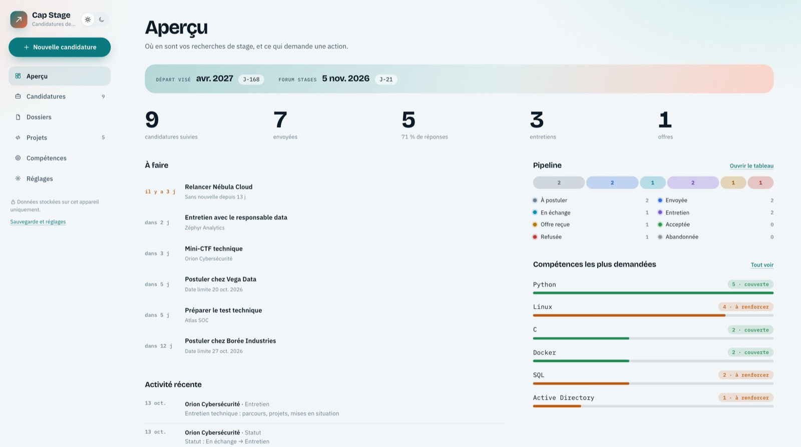</td>
<td width="50%">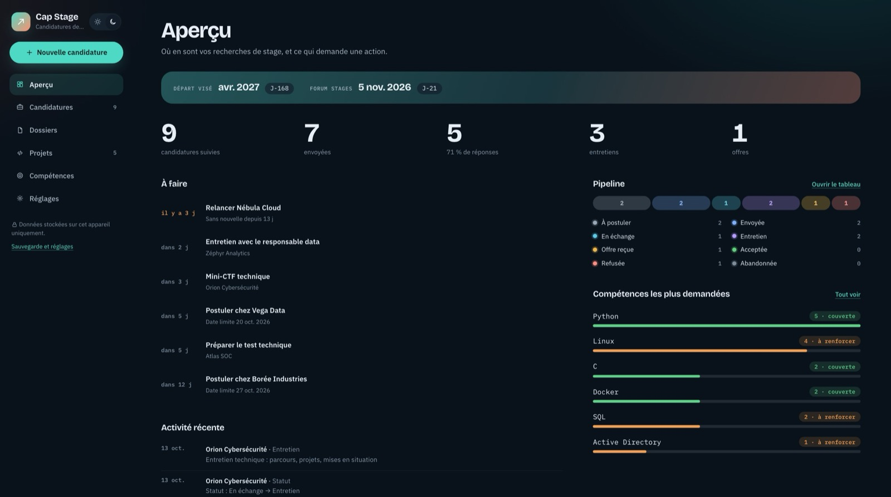</td>
</tr>
<tr>
<td><b>Un aperçu qui dit quoi faire</b><br><sub>Relances, échéances, pipeline et compte à rebours jusqu'au début du stage.</sub></td>
<td><b>Deux thèmes</b><br><sub>Clair ou sombre, au choix ou selon l'appareil.</sub></td>
</tr>
<tr>
<td>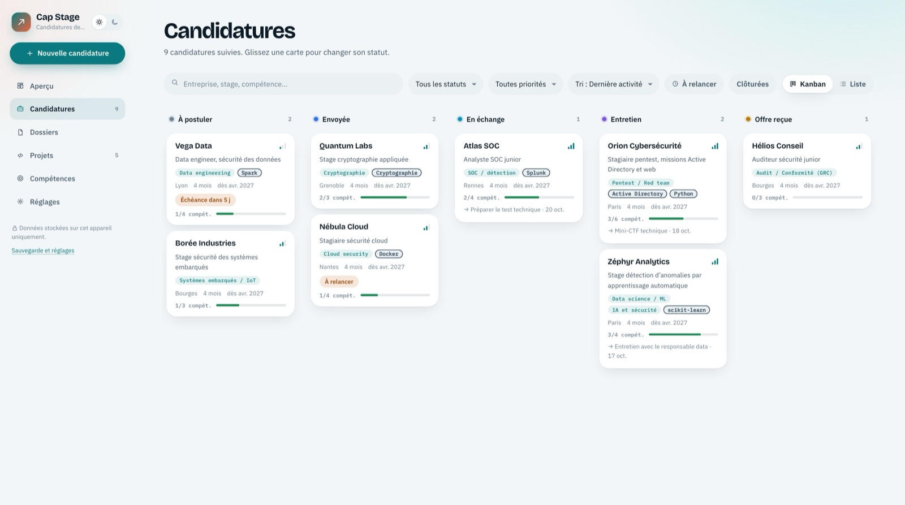</td>
<td>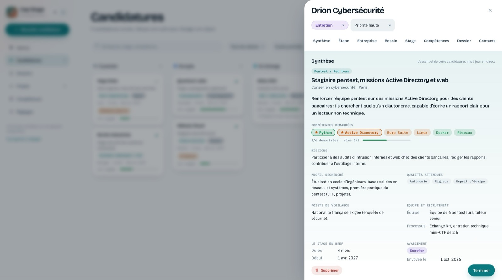</td>
</tr>
<tr>
<td><b>Le pipeline en un coup d'œil</b><br><sub>Cinq colonnes, glisser-déposer, ou vue en liste.</sub></td>
<td><b>Tout ce qu'il faut savoir sur une offre</b><br><sub>Domaine, ce que l'entreprise cherche vraiment, contraintes, équipe, processus, ce qui a été envoyé.</sub></td>
</tr>
<tr>
<td>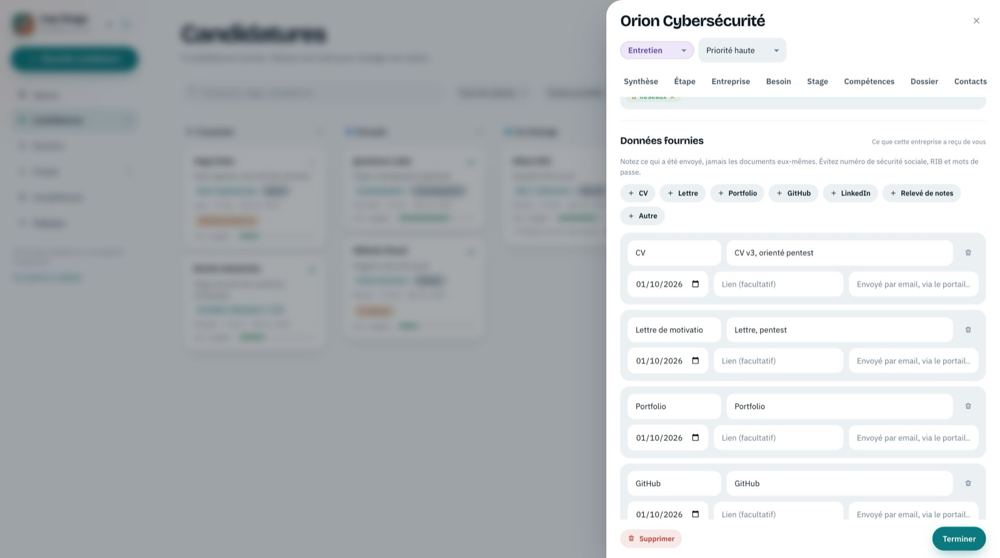</td>
<td>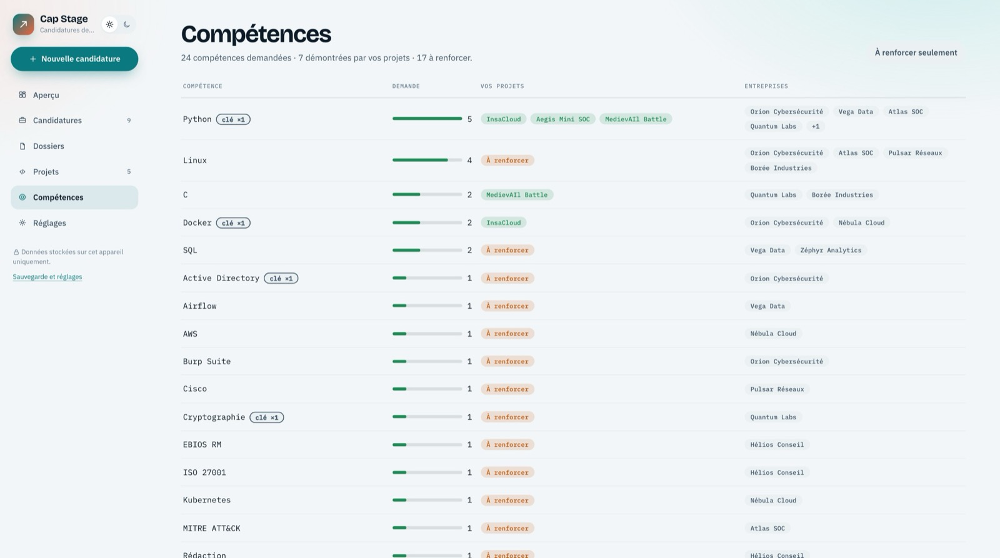</td>
</tr>
<tr>
<td><b>Compétences demandées, compétences clés</b><br><sub>Les projets qui les démontrent sont rattachés à la fiche.</sub></td>
<td><b>Ce que demandent les offres, face à ce que vous savez faire</b><br><sub>Chaque compétence demandée, les projets qui la démontrent, et celles « à renforcer ».</sub></td>
</tr>
</table>

<details>
<summary><b>Toutes les captures</b> (dossiers, projets, réglages, connexion, mobile)</summary>
<br>
<table>
<tr>
<td width="50%">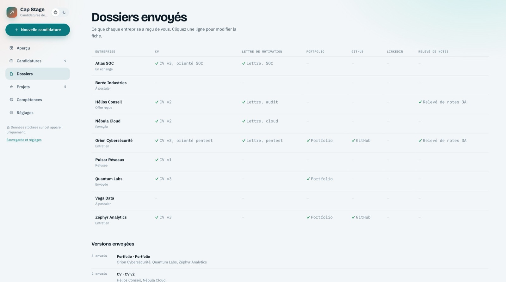</td>
<td width="50%">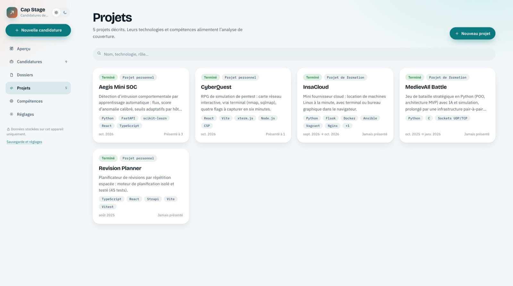</td>
</tr>
<tr>
<td><b>Dossiers</b><br><sub>CV, lettre, portfolio : la version envoyée à chaque entreprise, avec la date.</sub></td>
<td><b>Projets</b><br><sub>Contexte, rôle, technologies, résultats, liens, pitch.</sub></td>
</tr>
<tr>
<td>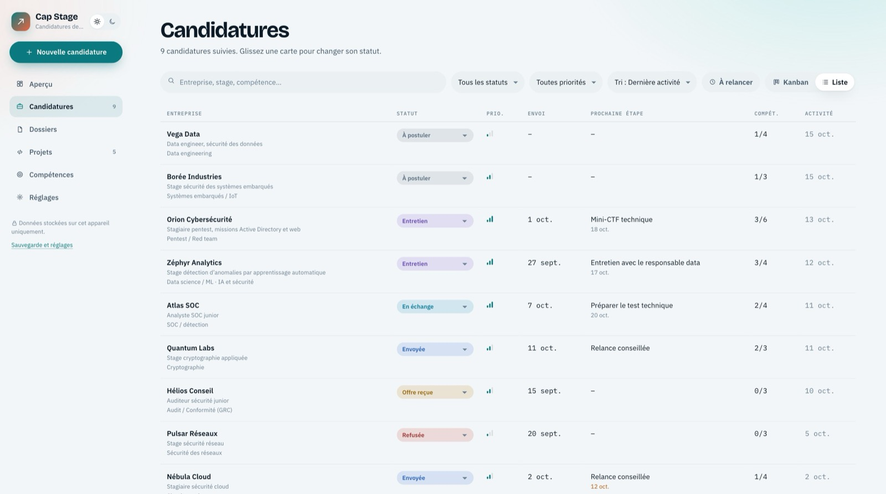</td>
<td>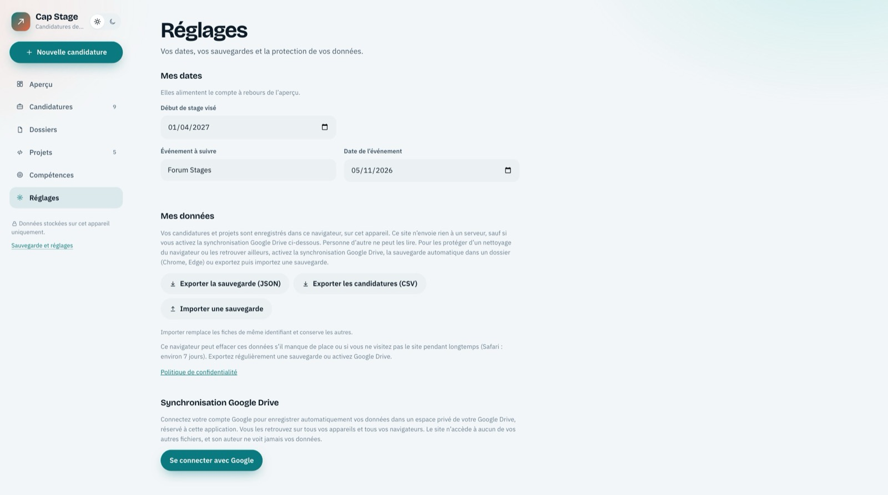</td>
</tr>
<tr>
<td><b>Vue en liste</b><br><sub>Recherche, filtres par statut, priorité et échéance, tri.</sub></td>
<td><b>Réglages</b><br><sub>Google Drive, dossier de sauvegarde, verrouillage, export, effacement.</sub></td>
</tr>
<tr>
<td>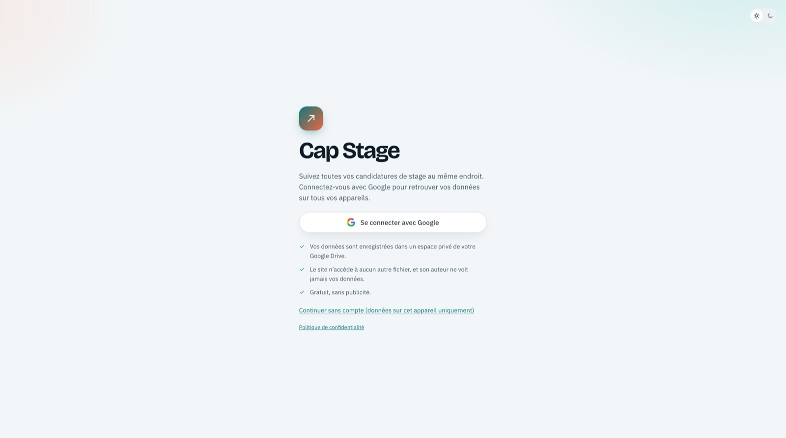</td>
<td>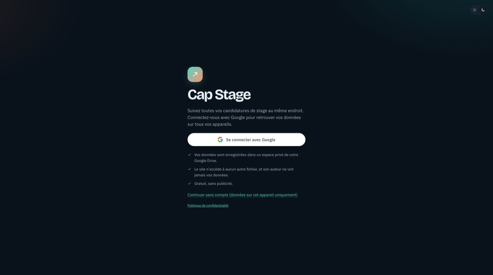</td>
</tr>
<tr>
<td colspan="2"><b>Première page</b><br><sub>Se connecter avec Google pour retrouver ses données partout, ou continuer sans compte.</sub></td>
</tr>
</table>

<p align="center">
  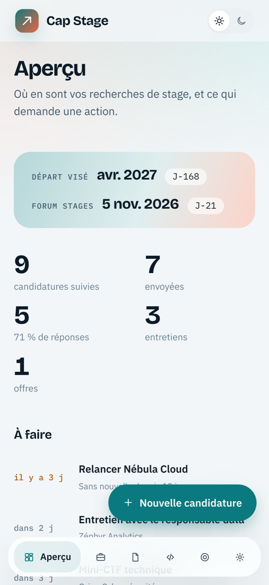
  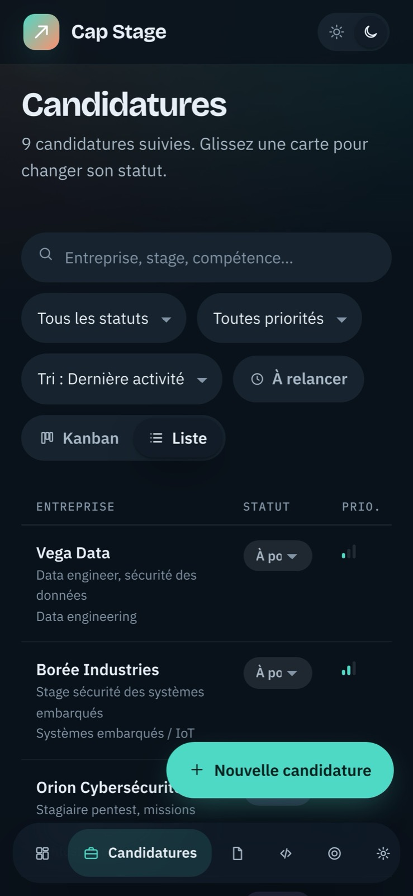
  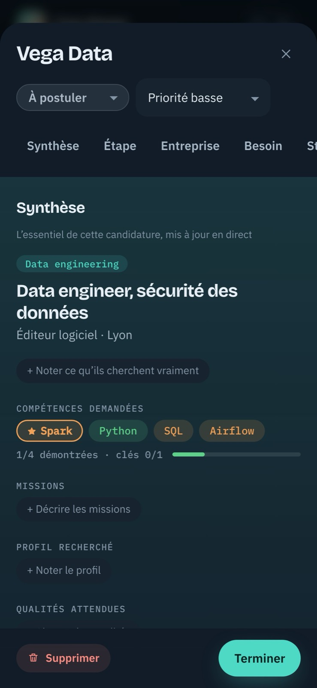
  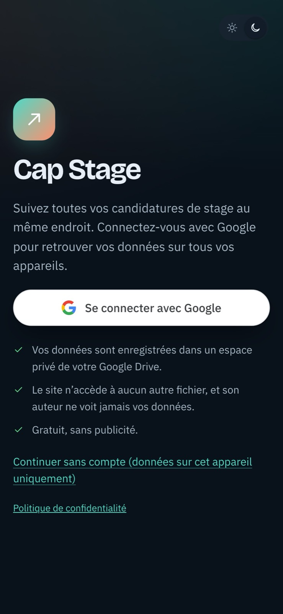
</p>
</details>

## Pourquoi c'est intéressant

Un outil de suivi paraît banal ; ce qui ne l'est pas, c'est de le rendre **gratuit, partageable avec des amis, et sans jamais détenir leurs données**.

- **Comment offrir des comptes sans base de données ?** Chaque personne se connecte avec Google, et l'application écrit un seul fichier dans l'espace caché de **son propre** Drive (`drive.appdata`). Le dépôt ne contient aucune donnée personnelle, et l'auteur ne peut pas lire celles des autres.
- **Comment demander le moins possible à Google ?** Trois autorisations non sensibles seulement : `drive.appdata`, `openid`, `profile`. Pas d'accès aux fichiers de l'utilisateur, donc aucune validation par Google à passer.
- **Que se passe-t-il sur un appareil partagé ?** Les données sont rattachées à l'identifiant opaque du compte Google. Une autre personne qui se connecte ne voit rien, et un bouton « Se déconnecter et effacer cet appareil » repart de zéro.
- **Comment rester utilisable sans compte ?** Tout fonctionne aussi en local seulement, avec un export JSON et CSV, une sauvegarde automatique dans un dossier (Chrome, Edge) et un rappel d'export.

## Fonctionnalités

| | |
|---|---|
| **Candidatures** | Une fiche par entreprise : statut, stage proposé, domaines, compétences demandées et compétences clés, ce que l'entreprise cherche vraiment, contraintes, équipe, processus, priorité. Kanban ou liste. |
| **Dossiers** | Ce qui a été envoyé à chacune (CV, lettre, relevé, portfolio, liens), version par version et avec la date. |
| **Suivi** | Contacts, historique des échanges, prochaine action, relances et échéances. |
| **Projets** | Une fiche complète par projet réalisé, rattachable aux candidatures qui le demandent. |
| **Compétences** | Ce que demandent les offres, comparé à ce que démontrent les projets. |
| **Aperçu** | Chiffres clés, pipeline, relances, compte à rebours jusqu'au début du stage. |
| **Thèmes** | Clair et sombre, ordinateur et mobile (barre de navigation flottante), utilisable au clavier. |

## Architecture

```
 Navigateur (index.html, un seul fichier, aucune dépendance)
 ┌──────────────────────────────────────────────────────────────┐
 │  Interface (DOM construit par h(), jamais d'innerHTML)       │
 │  Normalisation  fix() / parseBackup()  ← toute donnée lue    │
 │  Stockage : localStorage ─ coffre chiffré (AES-GCM, option)  │
 └───────┬───────────────────────┬──────────────────────────────┘
         │ à chaque modification │ à chaque modification
         ▼                       ▼
 Dossier choisi (File System   Google Drive de l'utilisateur
 Access, Chrome/Edge)          espace caché de l'application
 cap-stage.json · .csv         (drive.appdata, API Drive v3)
```

- **Données** : `apps` (candidatures), `projects` (projets), `settings` (début de stage visé, événement à suivre). Chaque document lu passe par une fonction de normalisation qui force les types, borne les énumérations et rejette les clés dangereuses.
- **Connexion Google** : modèle de jeton de Google Identity Services. Le jeton d'une heure reste en mémoire ; à l'expiration, l'écriture se met en pause et un bandeau propose de se reconnecter, puis les modifications sont réécrites.
- **Construction** : `build/build.py` assemble `index.html` et `confidentialite.html` depuis `build/source.html` et insère la politique de sécurité.

## Sécurité et vie privée

| Menace | Mesure |
|---|---|
| Envoi de données vers un tiers | `Content-Security-Policy` : sans identifiant Google, `connect-src 'none'` interdit tout réseau ; avec, seuls `accounts.google.com` et `www.googleapis.com` sont permis. Ni cookies, ni analyse, ni publicité. |
| Lecture des données sur l'appareil | Verrouillage optionnel : AES-256-GCM, clé dérivée du mot de passe par PBKDF2-SHA256 (310 000 itérations, sel aléatoire, vecteur d'initialisation neuf à chaque écriture). Le mot de passe n'est jamais stocké. |
| Appareil partagé | Données liées à l'identifiant du compte Google ; un autre compte ne voit rien. |
| Fichier de sauvegarde piégé | Taille limitée (8 Mo, 3 000 fiches), clés `__proto__` et `constructor` rejetées, normalisation de chaque champ. |
| Injection de code (XSS) | Aucun contenu saisi n'est injecté comme HTML ; liens limités à `http(s)`, ouverts avec `noopener`. |
| Saisie de données sensibles | Un détecteur de numéro de sécurité sociale, d'IBAN, de carte et de mot de passe avertit à la saisie. |
| Perte de données | Stockage persistant demandé, export JSON/CSV, copie précédente dans le dossier, rappel d'export. |

> **Limite assumée.** Le site partage son origine (`aziz3r.github.io`) avec le portfolio de l'auteur : une faille dans une autre page de cette origine pourrait lire le stockage local. Le verrouillage par mot de passe répond à ce risque ; il est recommandé dès que de vraies données sont saisies.

La [politique de confidentialité](https://aziz3r.github.io/cap-stage/confidentialite.html) détaille ce qui est enregistré et où.

## Le rapport

[`docs/rapport-cap-stage.pdf`](docs/rapport-cap-stage.pdf) (13 pages) : contexte, besoins, conception, modèle de données, sécurité et modèle de menaces, synchronisation et compatibilité des navigateurs, qualité et défauts corrigés, déploiement, limites, compétences mobilisées.

## Essayer en local

Aucune installation : le site est un fichier statique.

```bash
git clone https://github.com/aziz3r/cap-stage.git
cd cap-stage
python3 -m http.server 8780
# puis ouvrir http://localhost:8780/
```

Sans identifiant Google valide pour cette origine, la connexion Google est indisponible ; « Continuer sans compte » fonctionne.

## Régénérer le site

```bash
python3 build/build.py .          # avec l'identifiant client public de build/google-client-id.txt
python3 build/build.py . none     # sans Google : la page ne peut contacter aucun serveur
```

Le code source est dans `build/source.html`. L'identifiant client OAuth est public par nature ; aucun secret n'est présent dans le dépôt.

## Refaire les captures et la vidéo

`tools/capture.mjs` pilote Chrome par le protocole DevTools sur des données fictives (Node 22+, Google Chrome, ffmpeg).

```bash
python3 -m http.server 8780 &                    # depuis la racine du dépôt
node tools/capture.mjs /tmp/shots shots          # captures
node tools/capture.mjs /tmp/video video          # images de la vidéo
ffmpeg -f concat -safe 0 -i /tmp/video/frames/list.txt -vf "scale=1280:800,format=yuv420p" -c:v libx264 -crf 24 demo.mp4
```

## Structure du dépôt

```
cap-stage/
├── index.html                 le site (généré)
├── confidentialite.html       politique de confidentialité (générée)
├── build/
│   ├── source.html            code source de l'application
│   ├── build.py               assemblage + politique de sécurité
│   └── google-client-id.txt   identifiant client OAuth (public)
├── docs/
│   ├── demo.mp4               vidéo de démonstration
│   ├── rapport-cap-stage.pdf  rapport de projet
│   └── screenshots/           captures (clair, sombre, mobile)
└── tools/capture.mjs          captures et vidéo automatisées
```

## Limites assumées

- **Pas de fusion fine entre appareils** : si deux jeux de données diffèrent, l'utilisateur choisit celui à garder.
- **Le jeton Google dure une heure** : une reconnexion d'un clic est nécessaire à chaque session.
- **Dossier de sauvegarde** : indisponible sur Safari, Firefox et mobile, et dans le navigateur intégré de certains outils, où le sélecteur de dossier est refusé. L'outil le détecte, l'explique, et l'export reste disponible.
- **Pas de suite de tests automatisés** : la vérification repose sur des scénarios rejoués dans un navigateur piloté, avec des simulateurs pour Google et le dossier. **La connexion avec un véritable compte Google et le sélecteur de dossier natif restent à valider en conditions réelles** sur Chrome et Safari.
- Effacer les données du site dans le navigateur supprime les fiches qui n'ont été ni exportées ni synchronisées.

---

<sub>Réalisé seul par [Mohamed Aziz Baoueb](https://github.com/aziz3r), étudiant en 4ᵉ année STI à l'INSA Centre Val de Loire, pour suivre sa propre recherche de stage de 4 mois (avril 2027, cybersécurité et traitement de données) — puis proposé à ses amis.</sub>
